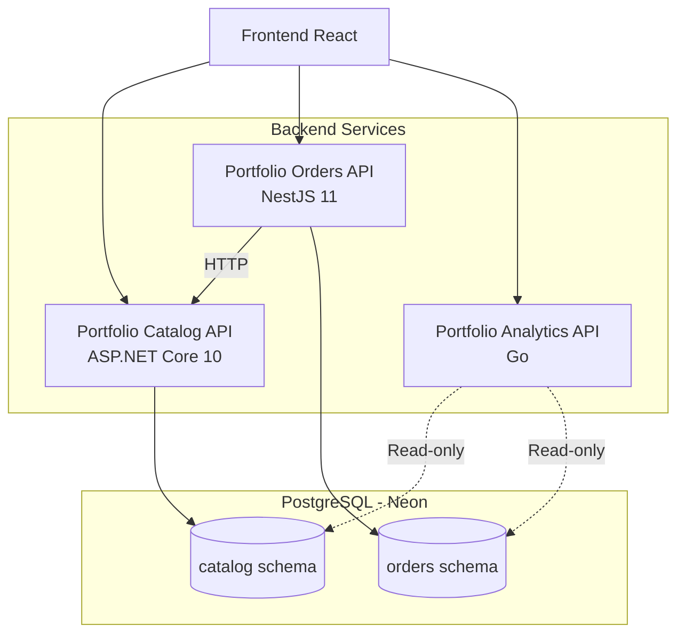

# Fullstack Showcase

Monorepo que reúne una plataforma Full Stack construida con diferentes tecnologías y arquitecturas backend. El proyecto busca demostrar el diseño, desarrollo e integración de servicios independientes dentro de un sistema distribuido, aplicando principios de separación de responsabilidades, persistencia compartida y despliegue en infraestructura cloud.

**Production:** [https://dubancaballero.dev](https://dubancaballero.dev)

## Objetivo del proyecto

Fullstack Showcase nace como un proyecto de demostración técnica para explorar diferentes tecnologías backend y sus enfoques arquitectónicos dentro de un mismo ecosistema.

En lugar de construir una aplicación monolítica, el sistema se divide en tres APIs independientes, cada una desarrollada con una tecnología diferente y responsable de un dominio específico.

Esta organización permite demostrar:

- Desarrollo de APIs REST con diferentes lenguajes y frameworks.
- Separación de responsabilidades mediante servicios independientes.
- Comunicación entre servicios a través de HTTP.
- Persistencia compartida con separación lógica de datos.
- Integración de diferentes tecnologías dentro de una misma solución.
- Configuración de entornos locales y despliegues independientes en la nube.

El proyecto también funciona como entorno de experimentación para explorar patrones de arquitectura, integración de servicios, seguridad y buenas prácticas de desarrollo.

## Arquitectura general

La solución utiliza una arquitectura distribuida compuesta por tres servicios backend independientes y un frontend que actúa como punto de entrada para consumir sus funcionalidades.

Cada API tiene una responsabilidad definida y es propietaria de su dominio de negocio.

### Diagrama de arquitectura



### Servicios

| Servicio | Tecnología | Responsabilidad |
|---|---|---|
| Portfolio Catalog API | ASP.NET Core 10 | Gestión de productos e inventario. |
| Portfolio Orders API | NestJS 11 | Gestión y procesamiento de pedidos. |
| Portfolio Analytics API | Go | Consultas, reportes y analítica de datos. |

#### Portfolio Catalog API

Responsable de administrar el catálogo de productos y el inventario.

Implementada con ASP.NET Core 10 utilizando Clean Architecture para separar las reglas de negocio, los casos de uso, la infraestructura y la exposición de endpoints REST.

Es la única responsable de modificar los datos pertenecientes al dominio del catálogo.

#### Portfolio Orders API

Responsable de gestionar los pedidos y sus operaciones asociadas, incluyendo los movimientos de inventario.

Implementada con NestJS 11 mediante una arquitectura modular basada en las convenciones del framework y Prisma ORM para el acceso a datos.

Cuando necesita consultar productos o modificar existencias, se comunica con Portfolio Catalog API mediante HTTP, evitando acceder directamente a las tablas que pertenecen al servicio de catálogo.

#### Portfolio Analytics API

Responsable de consultar información de los diferentes dominios para generar reportes y métricas.

Implementada en Go utilizando PostgreSQL como fuente de datos.

Tiene acceso de solo lectura a los esquemas necesarios para realizar consultas analíticas, sin modificar información perteneciente a otros servicios.

## Comunicación entre servicios

La comunicación entre componentes sigue un modelo de servicios independientes con responsabilidades claramente delimitadas.

### Flujo de solicitudes

El frontend consume directamente las tres APIs según la funcionalidad solicitada:

- Las operaciones de productos e inventario se dirigen a Portfolio Catalog API.
- Las operaciones relacionadas con pedidos se dirigen a Portfolio Orders API.
- Las consultas de reportes y analítica se dirigen a Portfolio Analytics API.

### Integración entre APIs

La comunicación entre servicios backend se realiza mediante HTTP cuando una operación requiere información o funcionalidades de otro dominio.

Por ejemplo, cuando se procesa un pedido:

1. Portfolio Orders API recibe la solicitud.
2. Consulta Portfolio Catalog API para obtener la información del producto.
3. Solicita al servicio de catálogo las operaciones necesarias sobre las existencias.
4. Gestiona el pedido y sus movimientos de inventario en su propio dominio.

De esta manera, cada servicio conserva el control de sus propias reglas de negocio y operaciones de escritura.

Portfolio Analytics API utiliza un enfoque diferente: consulta directamente los esquemas necesarios mediante permisos de solo lectura, evitando introducir dependencias HTTP para las consultas analíticas.

## Persistencia de datos

El proyecto utiliza PostgreSQL como sistema de gestión de bases de datos, compartiendo una misma instancia entre los servicios backend mediante separación lógica por esquemas.

Esta decisión permite mantener una infraestructura de base de datos sencilla sin perder la separación de responsabilidades entre servicios.

### Organización de esquemas

| Esquema | Propietario | Responsabilidad |
|---|---|---|
| `catalog` | Catalog API | Productos e inventario. |
| `orders` | Orders API | Pedidos, detalles y movimientos de inventario. |

### Usuarios y permisos

Cada servicio utiliza credenciales independientes con permisos específicos:

| Usuario | Permisos |
|---|---|
| `catalog_api` | Lectura y escritura en `catalog`. |
| `orders_api` | Lectura y escritura en `orders`. |
| `analytics_api` | Solo lectura en `catalog` y `orders`. |

Esta separación evita que un servicio modifique directamente los datos que pertenecen a otro dominio.

Aunque los servicios comparten una instancia PostgreSQL, mantienen la responsabilidad sobre sus propias tablas y operaciones.

## Tecnologías

### Backend

- C# / ASP.NET Core 10
- TypeScript / NestJS 11
- Go
- Entity Framework Core 10
- Prisma ORM 6
- PostgreSQL 17

### Infraestructura y herramientas

- pnpm Workspaces
- Docker / Docker Compose
- Render
- Neon
- AWS S3
- AWS CloudFront
- Cloudflare

## Estructura del monorepo

El repositorio está organizado mediante pnpm Workspaces para centralizar la gestión de los diferentes proyectos.

```text
fullstack-showcase/
├── apps/
│   └── web/                  # Frontend React
│
├── services/
│   ├── dotnet/               # Portfolio Catalog API
│   ├── nestjs/               # Portfolio Orders API
│   └── go/                   # Portfolio Analytics API
│
├── infrastructure/
│   └── docker/
│       └── docker-compose.yml
│
├── packages/                 # Reservado para paquetes compartidos
│
├── pnpm-workspace.yaml
└── package.json
```

Cada aplicación y servicio mantiene sus propias dependencias, configuración y documentación.

La carpeta `infrastructure` contiene configuraciones compartidas para el entorno local, mientras que `packages` queda reservada para posibles componentes reutilizables entre proyectos.

## Ejecución local

### Requisitos

- Git
- Node.js
- pnpm
- .NET SDK 10
- Go
- Docker y Docker Compose

### 1. Clonar el repositorio

```bash
git clone https://github.com/dknightdev/fullstack-showcase.git

cd fullstack-showcase
```

### 2. Instalar dependencias

Desde la raíz del monorepo:

```bash
pnpm install
```

### 3. Iniciar PostgreSQL

El entorno local utiliza Docker Compose para levantar la instancia de PostgreSQL compartida por los servicios.

```bash
docker compose -f infrastructure/docker/docker-compose.yml up -d
```

### 4. Configurar variables de entorno

Cada servicio requiere sus propias variables de entorno.

**.NET**

Configurar `ConnectionStrings__DefaultConnection` con la cadena de conexión de PostgreSQL.

**NestJS**

Configurar:

```env
DATABASE_URL=
CATALOG_API_URL=
CATALOG_TIMEOUT_MS=
PORT=
```

**Go**

Configurar:

```env
PORT=
DATABASE_URL=
APP_ENV=
```


### 5. Ejecutar las APIs

Cada servicio puede iniciarse de manera independiente.

**Portfolio Catalog API**

```bash
cd services/dotnet

dotnet restore
dotnet build
dotnet run --project src/Portfolio.Catalog.Api
```

**Portfolio Orders API**

Desde la raíz del monorepo:

```bash
pnpm --filter portfolio-orders-api prisma:generate
pnpm --filter portfolio-orders-api exec prisma migrate dev
pnpm --filter portfolio-orders-api dev
```

**Portfolio Analytics API**

Desde `services/go`, utilizando la ruta de entrada del servicio:

```bash
go run ./cmd/api
```

## Documentación de las APIs

Las tres APIs exponen documentación interactiva mediante Swagger UI y una especificación OpenAPI en formato YAML.

| Servicio | Swagger UI | OpenAPI |
|---|---|---|
| Catalog API | `/swagger/` | `/openapi.yaml` |
| Orders API | `/swagger/` | `/openapi.yaml` |
| Analytics API | `/swagger/` | `/openapi.yaml` |

### Health checks

Cada API proporciona dos endpoints para verificar su estado:

| Endpoint | Descripción |
|---|---|
| `/health` | Verifica que el servicio esté funcionando. |
| `/health/ready` | Verifica que el servicio esté preparado para recibir solicitudes, incluyendo la conexión con la base de datos. |

## Infraestructura y despliegue

El proyecto utiliza diferentes proveedores para alojar los componentes de la solución.

### Entorno local

Docker Compose permite levantar PostgreSQL localmente para que los servicios puedan desarrollarse y probarse de manera independiente.

La configuración se encuentra en:

`infrastructure/docker/docker-compose.yml`

### Producción

| Componente | Proveedor | Responsabilidad |
|---|---|---|
| Catalog API | Render | Ejecución de la API .NET mediante Docker. |
| Orders API | Render | Ejecución de la API NestJS. |
| Analytics API | Render | Ejecución de la API Go. |
| PostgreSQL | Neon | Base de datos compartida. |
| Frontend | AWS S3 | Almacenamiento de archivos estáticos. |
| Distribución | AWS CloudFront | Distribución del frontend mediante CDN. |
| DNS | Cloudflare | Gestión del dominio y configuración DNS. |


## Roadmap

El proyecto está diseñado para evolucionar progresivamente mediante nuevas funcionalidades y experimentos técnicos.

Algunas áreas de exploración incluyen:

- Autenticación y autorización entre servicios.
- Ampliación de las funcionalidades de las APIs.
- Nuevas integraciones y patrones de comunicación.
- Evolución de la arquitectura y observabilidad.
- Incorporación de nuevas tecnologías y servicios.
